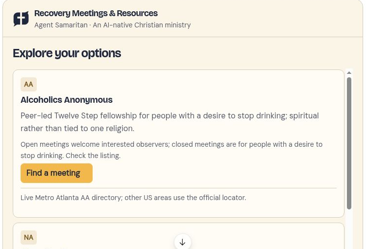

# Agent Samaritan: Recovery

Find a peer recovery meeting that fits your day, check the access details, or find support for someone close to you.

[Connect with Claude, ChatGPT, Muse Code, or Grok](PROVIDERS.md)

Look for a local meeting by ZIP code and time window, or an online group with a published joining link. The service searches Metro Atlanta AA schedules and U.S. NA listings from participating service bodies. Official locators extend the search to other regions, SMART Recovery and Celebrate Recovery.

Agent Samaritan is a Christian ministry that helps people of any faith find independent recovery meetings and family support. It is free, needs no account and has no religious requirement. It is not a counseling or crisis service.

## Try it

- "Find the first three Friday evening AA meetings within 15 miles of ZIP 30075 and show their accessibility information."
- "Find online NA meetings after 6 p.m. Friday. Include the original time zone for each."
- "Which programs offer secular meetings, and where can a family member find a support group?"
- "My brother asked me to come to a meeting with him. Which ones near 30303 are open?"

## What is included

### Skills

| Skill | What it does |
| --- | --- |
| `find-a-meeting` | Finds in person, hybrid and online meetings by ZIP, fellowship, day and time, shows open or closed status and accessibility as listed, and refreshes one listing before you go. Says plainly when a listing is old and when an area or fellowship has only an official locator. |
| `explore-peer-support` | Describes AA, NA, SMART Recovery and Celebrate Recovery in each program's own terms, without ranking them, and gives each official directory and the official treatment locator. |
| `find-family-support` | Finds peer support for relatives and friends, such as Al-Anon, Nar-Anon and SMART Family & Friends, and explains open meetings a supporter may attend. |

Each skill reads notes kept beside it in a `references` folder: coverage and sources, meeting fields, time zone handling, and rules on anonymity and neutral wording.

### Agent

`meeting-access-researcher` is a read only helper. Claude can hand it a meeting request that needs several lookups, such as checking a shortlist one by one or converting online meeting times to your time zone. It returns verified schedules, joining or location details, accessibility as recorded, listing freshness and coverage gaps. It can use the five search and detail tools only.

### Hooks

None. This plugin runs no scripts on your machine.

## Get started

In Claude Code, run these commands in a session and reload plugins if prompted.

```text
/plugin marketplace add OpZero-sh/plugins
/plugin install agent-samaritan-recovery@opzero
```

In Claude chat or Cowork, open the installed plugin's Connectors tab and connect Agent Samaritan: Recovery. You can use the directories without sharing your recovery history. Select a result to check the source listed schedule and location or joining link.

## What the plugin runs, sends and fetches

- **One remote MCP server.** The plugin connects to `https://agent-samaritan-recovery.mcp.opzero.sh/mcp`, run by OpZero. It is declared in `.mcp.json`. It needs no sign in. The plugin contacts no other host.
- **What a search sends.** A local search sends a five digit ZIP, the fellowship and your day, time, distance and format filters. An online search sends the fellowship and time filters. A detail lookup sends a meeting ID. No name, history or street address is requested.
- **What the server looks up.** The hosted service fetches public meeting feeds and returns the source with every listing: the Metro Atlanta AA directory, a public aggregator of NA service body meeting lists, and a public ZIP lookup for an approximate centre point. For SMART Recovery, Celebrate Recovery and AA outside Metro Atlanta it returns official locator links for you to open yourself.
- **No hooks and no local code.** The plugin holds skills, one agent and the connector declaration.
- **Optional developer files, never run by the plugin.** The two helper scripts are not in this repository. They live in the catalog repository, https://github.com/OpZero-sh/plugins, and do something only if you clone it and run them yourself.
  - `tools/build_openai.py` in the catalog builds a ZIP of this plugin for ChatGPT and Codex. It reads the skills, the license, the plugin icon and the files in `integrations/openai`, and writes ZIP files to the folder you name. It makes no network request.
  - `tools/grok_example.py` in the catalog is a sample for the xAI API. With `--dry-run` it only prints the request. Without it, it reads `XAI_API_KEY` (and the optional model name `XAI_MODEL`) from your environment and sends your question and the server list in `integrations/grok-servers.json` to `https://api.x.ai/v1/responses`.
  - `.muse-plugin/plugin.json`, `integrations/openai/plugin.json` and `integrations/openai/mcp.json` are manifests for other clients. They name the same server.

## Limits and urgent help

Listings are recurring schedules from public directories. They can be out of date, and some source records have not changed in more than six months. Confirm with the meeting's source page or the fellowship's local line before you travel, especially around holidays. An empty result does not mean there are no meetings. It means this service has no listing for that search.

Meetings are peer support. They are not medical care. If you are in immediate danger or facing a medical emergency in the US, call 911. For crisis support, call or text 988 or use the chat at https://988lifeline.org/chat/. For treatment referral and information, the SAMHSA National Helpline is 1-800-662-4357, and https://findtreatment.gov/ lists treatment providers.

## In use

Examples from the connected services in Claude.


